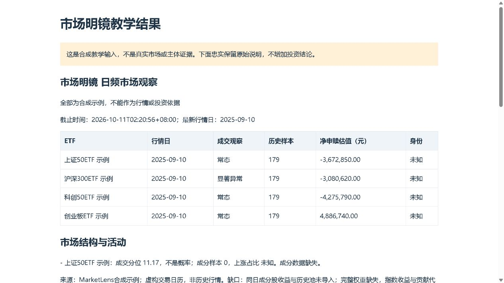

# 市场明镜 MarketLens

核对市场消息的依据、推断和证据缺口，说明哪些判断有支持、适用到哪里，以及什么新资料会改变判断。

[](LICENSE) · [当前发行版 v0.5.1](https://github.com/KILING-TASI/marketlens/releases/tag/v0.5.1) · [运行检查](https://github.com/KILING-TASI/marketlens/actions)

## 能解决什么问题

**这消息可信吗？回购兑现了吗？指数涨，为什么多数股票没涨？**

市场明镜独立维护消息、市场观察和证据分析；工作台组织研究并按需薄调用。先给证据能够支持的限定结论，再解释支持、反对、局部支持、背景和未知；软件状态不替代原文核验。

新增[论证结构](references/argument-structure.md)、[竞争解释](references/competing-hypotheses.md)和[中外理论来源](references/theory-sources.md)。AI建议关联与声明已复核关联分别记录，未复核建议不参与主张状态。

[查看消息论证教学报告](references/examples/argument-preview/report.html)（下载完整源码后打开；教学数据，原文未认证）。

## 快速开始

从[发行页](https://github.com/KILING-TASI/marketlens/releases/tag/v0.5.1)下载完整源码并解压，需要 Python 3.10 或以上。在源码目录执行：

```text
python try_demo.py --no-open --out-dir reports/first-demo
```

按提示打开新生成的 HTML。Windows 也可双击 `Start-Demo.cmd`，Linux/macOS 可用 `sh Start-Demo.sh`。教学使用原创模拟资料，不自动取真实数据；重复运行使用新目录，历史结果保留。

[查看已保存的报告示例](examples/teaching-report.html)。HTML请随完整源码下载后打开；示例按自身生成日期和口径阅读。



图片是历史示例，不能推定全部新报告已完成视觉验收。

## 使用自己的资料

先按[资料准备](BEGINNER.md)填写输入，再看[详细命令与方法](USAGE.md)。需要安装CLI时，在自己的Python环境运行：

```text
python -m pip install .
marketlens --help
```

仓库、Python发行包、安装命令及Skill注册名均为 `marketlens`。CLI安装和Skill注册是两个步骤：自然语言调用按[SKILL.md](SKILL.md)配置，保留完整资源；不必安装全部仓库。安装普通构建依赖可能联网，教学流程不需要作者缓存。

## 结果范围

公告计划不等于执行，成交放量不证明买方身份；限定样本不能外推全市场。

报告中的来源、日期、假设和未知事项需一起阅读。程序运行成功不等于来源已经认证、资料完整或投资判断有效。原创代码采用MIT，第三方代码、公告、研报和数据仍按各自权利范围处理。

## 文档与维护

- [详细命令与方法](USAGE.md)
- [资料准备与排错](BEGINNER.md)
- [Skill调用指引](SKILL.md)
- [版本记录](CHANGELOG.md)
- [许可与第三方范围](THIRD_PARTY_NOTICES.md)
- [审计范围](AUDIT_SCOPE.md)
- [扩展专题](EXPANSION.md)

[贡献说明](CONTRIBUTING.md) · [安全反馈](SECURITY.md) · [更新与清理](LIFECYCLE.md) · [English](README.en.md)

[按问题选择其他工具](https://github.com/KILING-TASI/research-workbench/blob/main/references/tool-navigation.md)。共12个活跃仓，资料契约校验已并入[数据仓](https://github.com/KILING-TASI/cn-data-adapters/blob/main/CONTRACT_MIGRATION.md)。各仓分别发布；main的后续文档整理不改写旧发行包和冻结结果。

## v0.3.5 消息论证与竞争解释

保留旧消息对照入口；新增推理依据、适用限定、推翻条件、提出与复核记录及定性竞争解释矩阵。新报告第一屏展示六类证据状态，来源和未知一起阅读。参见[使用说明](USAGE.md)。

## 独立原文核对（v0.4.0）

先取得原文，再核对摘要、完整摘录、定位、版本和反证。支持带符号的公告指标与预告偏离提示，仅读取和核查不代表认证真伪。

| 要解决的问题 | 入口 |
|---|---|
| 只有公开原文链接 | `marketlens sources fetch --url HTTPS地址 --out-dir 新目录` |
| 已有原文件，需要准备输入 | `marketlens sources scaffold --source 原文件.md --out input.json` |
| 核对原文与公告指标 | `marketlens sources review --input input.json --out-dir 新目录` |
| 查看独立教学流程 | `python scripts/run.py sources review --input references/examples/source-announcement.json --out-dir 新目录` |

完整说明见[原始资料核对](references/source-verification.md)。PDF可选组件、失败原因、相对路径及未核事项分别说明；不要求其他仓库。

## v0.5.0 深入证据核对

原文匹配之后，继续核查证明范围、身份与时间、部分否认、反证查找记录和版本影响。正文分别说明能确认、不能确认和下一步；不把匹配或复核声明当真实性认证。

| 要核什么 | 使用入口 |
|---|---|
| 上传文件是否对应来源地址 | `sources review --verify-urls`，显式下载比较 |
| 原句有没有漏掉限定 | 全文提示、前后文、表头脚注及提取缺口 |
| 哪个部分有依据 | 主体、动作、金额、期间、阶段等逐项复核 |
| 新资料影响哪些判断 | `sources compare`，保留冻结报告 |

见[深入核对说明](references/evidence-depth.md)与[完整原创案例](references/examples/evidence-depth.json)。
